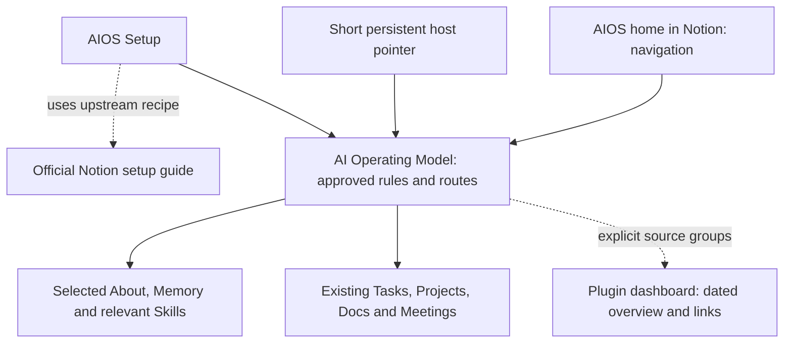

# AIOS

AIOS gives AI agents reusable working methods and a shared context home.
Use it for everyday work, research, content and software projects in the agent
app you already use. Your app still provides the models, tools and permissions.

## Why I built this

I built AIOS to carry useful context, decisions and working methods between AI
apps, so each conversation can build on the work that came before.

AIOS installs as a native plugin in Codex and Claude Code and adds reusable
skills for planning, building, reviewing and writing. It builds on open formats
such as Agent Skills and on what those apps already provide, so I mostly write
methods and small adaptations, with little code to maintain.

Your context stays in a home you choose, such as Notion or a repository. The app
provides the models, tools and permissions; AIOS helps the assistant find and
maintain the context it needs.

## Install

Choose your app, install AIOS, then start a fresh session.

**Codex**

```sh
codex plugin marketplace add onlinesourdough/AIOS-Plugin
codex plugin add aios@online-sourdough
```

**Claude Code**

```sh
claude plugin marketplace add onlinesourdough/AIOS-Plugin
claude plugin install aios@online-sourdough --scope user
```

**Pi**

```sh
pi install git:github.com/onlinesourdough/AIOS-Plugin
```

**Gemini CLI**

```sh
gemini extensions install https://github.com/onlinesourdough/AIOS-Plugin
```

**Copilot CLI**

```sh
copilot plugin marketplace add onlinesourdough/AIOS-Plugin
copilot plugin install aios@online-sourdough
```

These commands follow the repository's current `main` branch. See the
[installation guide](docs/native-installation.md) for fixed versions and
compatibility. Copilot's route is documented but has not been tested locally.
[Cursor and OpenCode](skills/aios-setup/references/adapter-other.md) have
separate setup requirements. Never paste access tokens into a chat.

Then ask: **“Help me set up AIOS using my existing workspace.”**
Setup reuses suitable sources, saves the app's short context pointer and checks
one useful task with you. Installing the plugin alone changes none of this.

## How it fits together

**AIOS** is the plugin and your home. Your **AI Operating Model** is the one
guide you approve: where your information lives and how agents read and
maintain it. Setup follows Notion's official setup guide, records which version
it used, and keeps your model's own revision separate. For a new Notion setup
the model is a page in a private document database, and a small AIOS home page
can link to it; an existing guide stays where it is. Nothing is moved just to
fit a diagram.



Arrows show references and responsibilities, not containment or shared access.
Soul, Spaces and imports are optional. Setup reuses your existing Tasks,
Projects, Skills and meeting notes before creating anything, and uses Notion's
own database types when something is really missing. Whether your connection
supports native Memory and Skills, and how a given app follows the pointer, are
checked during setup rather than assumed.

Your skill pages stay where they are; in Notion you enable them for yourself in
**Library**, and that never grants anyone page access. Agents use Notion through
a connection: in Codex, the official Notion plugin, or a direct connection to
Notion's hosted MCP server. Setup checks which tools the connection on your
actual machine can call, reuses one that works, and offers the direct
connection only when a needed tool such as skill discovery is missing.

Agents read the model once per session for work that uses your context, plus
Soul only if the model lists it as standing context, then only the sources the
task needs. Independent
repository work starts from its own instructions instead. Lessons belong in
Memory; artifacts stay with the documents or projects that own them; task
systems keep live status. Another connected agent can follow the same model
without installing AIOS.

In Codex, the **AIOS** sidebar shows a dated overview of your selected model's
sources and saves the pointer only when you choose Save pointer. It is
navigation, not a live view; see [sidebar behavior](docs/sidebar.md).

## Skills

Use ordinary language, or invoke a skill directly where your app supports it.
The plugin includes these 22 methods:

| Skill | What it helps with |
| --- | --- |
| [AIOS](skills/aios/SKILL.md) | Use relevant owner context and choose methods for the task. |
| [Setup](skills/aios-setup/SKILL.md) | Connect the host and context home, then complete a useful first task. |
| [Context](skills/aios-context/SKILL.md) | Find the right context sources and adapt the chosen home. |
| [Maintain Context](skills/aios-maintain-context/SKILL.md) | Save useful facts and corrections in their existing owning records. |
| [Check](skills/aios-check/SKILL.md) | Inspect installation and context health without changing them. |
| [Update](skills/aios-update/SKILL.md) | Adopt or roll back a reviewed AIOS version or a selected System. |
| [Manage Skills](skills/aios-manage-skills/SKILL.md) | Create, improve, install, update or remove reusable methods. |
| [Interview](skills/aios-interview/SKILL.md) | Explore an unclear goal and find a useful direction. |
| [Create Project](skills/aios-create-project/SKILL.md) | Start a useful workspace for research, business, content or code. |
| [Spec](skills/aios-spec-work/SKILL.md) | Define the outcome, boundaries and evidence needed for substantive work. |
| [Build](skills/aios-build-work/SKILL.md) | Implement and verify accepted work. |
| [Review](skills/aios-review-work/SKILL.md) | Check a result against its requirements or audit repository drift. |
| [Ship](skills/aios-ship-work/SKILL.md) | Deliver an authorized result and verify the destination. |
| [Risky Changes](skills/aios-risky-changes/SKILL.md) | Assess consequential changes and their recovery needs. |
| [Orchestrate Workers](skills/aios-orchestrate-workers/SKILL.md) | Coordinate delegated work while retaining responsibility for acceptance. |
| [Select Model](skills/aios-select-model/SKILL.md) | Choose a sufficient model and reasoning level for the remaining work. |
| [Triage Improvement](skills/aios-triage-improvement/SKILL.md) | Turn a concrete improvement signal into a deduplicated, authorized issue. |
| [Clarify](skills/clarify/SKILL.md) | Explain a complex topic with concrete examples and useful visuals. |
| [Human Writing](skills/human-writing/SKILL.md) | Write clear, natural prose for the intended reader. |
| [Write Code](skills/write-code/SKILL.md) | Write or revise code, scripts and automation with appropriate checks. |
| [Content](skills/content/SKILL.md) | Create, revise or reuse content and configure a repeatable content workflow. |
| [Diffusion Studio](skills/diffusion-studio/SKILL.md) | Use the optional external video editor for edits, captions and export. |

Combine methods when useful: develop an idea with Interview, produce it with
Content, review the result, and save a reusable workflow through Manage Skills.
Your personal methods stay in your chosen Skills source; shared AIOS methods
stay in the plugin.

## Your context home

Notion is the recommended starting point for personal and small-team setups.
An established file-based or other supported home can stay in place. Setup
adapts to your existing tools, access and personal or business workflows, and
creates only the destinations you need.

You own the operating model and your data. The host controls tools and
permissions; the plugin supplies working methods. Maintenance happens during
authorized work; background synchronization needs a separately configured
mechanism. A consultant can use a client's home without replacing their own
default.

## Update or remove

Use the same app and installation scope you originally chose. Finish active
work before changing its methods. Updates leave your context home, operating
model and personal methods intact, and removing the plugin does not delete them.

| App | Update | Remove |
| --- | --- | --- |
| Codex | Refresh the AIOS marketplace, then reinstall its AIOS entry; see the guide below for pinned sources | `codex plugin remove aios@online-sourdough` |
| Pi | `pi update --extension git:github.com/onlinesourdough/AIOS-Plugin` for a tracking install | `pi remove git:github.com/onlinesourdough/AIOS-Plugin` |
| Claude Code | `claude plugin marketplace update online-sourdough`, then `claude plugin update aios@online-sourdough --scope user` | `claude plugin uninstall aios@online-sourdough --scope user` |
| Gemini CLI | `gemini extensions update aios` | `gemini extensions uninstall aios` |
| Copilot CLI | `copilot plugin marketplace update online-sourdough`, then `copilot plugin update aios@online-sourdough` | `copilot plugin uninstall aios@online-sourdough` |
| Cursor | Refresh the selected marketplace and manage AIOS in Customize | Remove AIOS in Customize |

Pinned versions and local sources need their own update selection. See
[installation and removal](docs/native-installation.md) and
[recovery](docs/recovery.md) before replacing an existing registration. A
separately configured host pointer is not removed by the package manager.

## More

[Skills](docs/skills.md) · [Overview](docs/aios.md) ·
[Architecture](docs/architecture.md) · [Verification](docs/verification.md) ·
[Contributing](AGENTS.md) · [Security](SECURITY.md) · [Changelog](CHANGELOG.md) ·
[MIT license](LICENSE)
