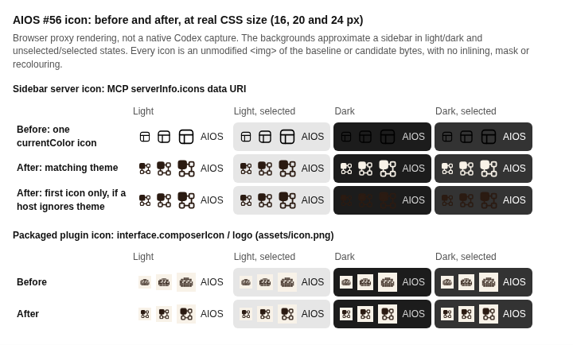

# Issue #56 icon: before and after

[comparison.html](comparison.html) is a self-contained browser page that shows the
baseline and candidate icons at 16, 20 and 24 CSS px on proxy sidebar backgrounds
(light and dark, unselected and selected). Open it in any browser to reproduce the
capture. It is a browser proxy, not a native Codex screenshot.

[comparison.png](comparison.png) is that page captured by the T3 headless browser at
720 CSS px wide and device scale 1, so the icons appear at their real size.

Every icon on the page is an unmodified `` of the baseline release's bytes or
the candidate's emitted and packaged bytes:

- Server icon, before: the `serverInfo.icons` data URI that the 0.29.0 bundle
  (`4f39212`, `runtime/sidebar/server.cjs`) returns over stdio.
- Server icon, after: both themed data URIs that the candidate bundle returns.
- Plugin icon: `assets/icon.png` at `4f39212` and in the candidate.

Observed in a T3 headless browser render (2026-10-13): the baseline's
`currentColor` SVG renders black as an image and nearly vanishes on dark
backgrounds. The candidate's theme-matched variants stay visible on all four
backgrounds. A host that ignores `theme` and shows only the first icon would
still show the dark-ink variant on dark backgrounds, as the baseline did.

Whether Codex reads `theme`, and which icon its sidebar shows, is not established
here. Installed Codex proof is pending.
